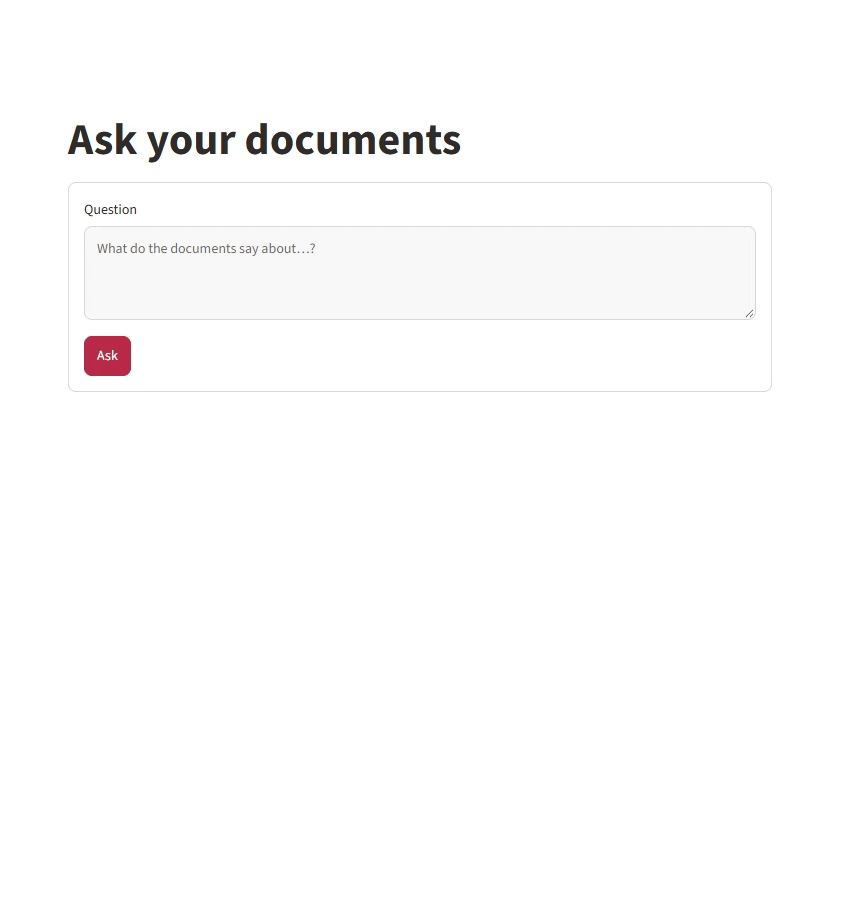
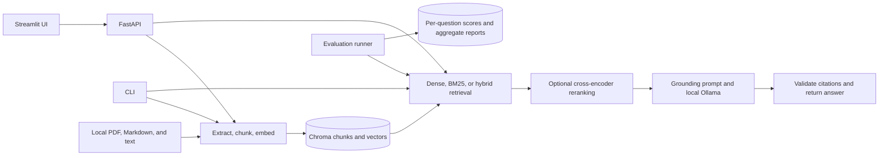

# Local RAG

Ask questions about local PDF, Markdown, and plain-text documents and inspect the passages cited in each answer.

## Demo



## Architecture



## Setup on Windows

1. Install [uv](https://docs.astral.sh/uv/getting-started/installation/) and [Ollama](https://docs.ollama.com/windows). Start Ollama and run these commands from the repository root.

   ```powershell
   ollama pull qwen3:8b
   uv sync
   uv run python -c "from sentence_transformers import SentenceTransformer; from pathlib import Path; from rag.config import load_config; c = load_config(Path('config.yaml')); SentenceTransformer(c.embedding.model_name, device=c.embedding.device)"
   ```

2. Create `data/raw/` and place your PDFs, Markdown, and UTF-8 text files inside it. The model downloads are a one-time setup step. The default configuration loads cached embedding weights and sends generation requests to loopback only.

3. Build the index and ask a question.

   ```powershell
   uv run python -m rag.cli index
   uv run python -m rag.cli ask "What does the guide say about temporary files?"
   ```

   When the virtual environment is active, the same commands work without `uv run`. To use a different corpus or store, pass `--config path/to/config.yaml` before the subcommand. Relative paths resolve from that YAML file.

## Local API and UI

From the repository root, start FastAPI and Streamlit in separate terminals. Keep Ollama running.

```powershell
# Terminal 1
uv run uvicorn rag.api:app --host 127.0.0.1 --port 8000 --workers 1

# Terminal 2
uv run python -m streamlit run app/ui.py --server.address 127.0.0.1 --browser.gatherUsageStats false
```

Open the address printed by Streamlit, usually [the local UI](http://127.0.0.1:8501). Submit a question, expand a cited source to see the chunk and its location, or expand **Retrieval scores** to inspect the entire top-k ranking. The score label identifies the ranking stage. Scores from different stages use different scales.

| Endpoint | Behavior |
| --- | --- |
| `POST /ask` | Accepts a JSON object with a `question` string. Returns the answer, cited chunks, ranked retrieval scores, abstention reason when applicable, request ID, and latency in milliseconds. |
| `POST /index` | Rebuilds the index from the configured local corpus and returns `indexed_chunks`. The request waits for the rebuild to finish. |
| `GET /health` | Reports API liveness and checks for an index pointer and the configured Ollama model. Returns HTTP 200 with `status: degraded` when a prerequisite is missing. |

```powershell
Invoke-RestMethod http://127.0.0.1:8000/health
Invoke-RestMethod http://127.0.0.1:8000/index -Method Post
$body = @{ question = "How should I set newline when opening a file for csv.reader?" } | ConvertTo-Json
Invoke-RestMethod http://127.0.0.1:8000/ask -Method Post -ContentType 'application/json' -Body $body
```

The API and UI read `config.yaml` by default. To use another config, set `$env:RAG_CONFIG = "config.hybrid.yaml"` in both terminals before starting them. If you change the API port, match `web.api_url` to the Uvicorn address. Review the [local API schema](http://127.0.0.1:8000/docs) while the API is running.

Each accepted ask request emits a `rag_query` JSON event in the API log with its request ID, HTTP status, elapsed milliseconds, retrieval mode, chunk counts, and abstention reason. Latency covers queueing for the local model, retrieval, and generation. The event excludes the question, answer, and source text.

## Retrieval and chunking

Inspect retrieval or debug an answer with:

```powershell
uv run python -m rag.cli retrieve "What does the guide say about temporary files?"
uv run python -m rag.cli ask --debug "What does the guide say about temporary files?"
```

`retrieve` prints ranked chunks, retrieval scores, source locations, and text previews without calling Ollama. `ask --debug` writes the retrieved chunks, approximate prompt token count, raw model response, and any abstention reason to stderr. The token estimate counts both system and user text at roughly four UTF-8 bytes per token and excludes Ollama's chat template. A count of zero means no prompt was sent. `no_chunks_retrieved` also covers the case where no retrieved chunk fits the prompt budget.

- Set `retrieval.mode` to `dense` for cosine search, `bm25` for lexical BM25+, or `hybrid` for weighted reciprocal rank fusion. BM25 builds an in-memory lexical index from the active Chroma snapshot and reuses it across an evaluation run. Dense stays the default.
- In hybrid mode, an item's score is the sum of `weight / (rrf_k + rank)` over the lists containing it. Ranks start at 1. `hybrid_weight` is the dense weight, and BM25 gets the remainder. Use 0 for only the lexical ranking or 1 for only the dense ranking.
- `candidate_k` controls the number of candidates per retrieval method in hybrid mode and the number sent to the optional reranker. It is treated as at least `top_k`. The final top-k score is cosine similarity, BM25+, the fused score, or the cross-encoder score, depending on the last stage.
- Fixed chunking can count characters or embedding-model tokens. It snaps to whitespace and adjusts overlap to keep whole words and make progress. A single word longer than the chunk size gets its own oversized chunk.
- Set `chunking.strategy: heading` to split Markdown at ATX and Setext headings and plain text at recognized underlined section titles, including Python's exported docs. It runs word-safe windows inside each section. PDF pages retain page-local fixed windows. Image-only pages require OCR before ingestion.
- Citations use the URL-encoded path relative to the corpus and a zero-based document-wide chunk index. The CLI displays the filename, one-based PDF page where applicable, half-open character offsets into the extracted text, and the cited passage.
- The prompt includes whole passages that fit a conservative context budget. Missing or unknown citation IDs trigger abstention. This checks citation membership. The language model still determines whether the cited passage supports its claim.
- Embeddings run on CPU by default, leaving GPU memory for Ollama. The supplied dependency profile installs CPU PyTorch. Re-run `index` after changing the documents, chunking, or embedding model.

To enable reranking, cache the configured model once and set `reranking.enabled: true`. The default model runs on CPU and the evaluator loads it once per run. [Sentence Transformers CrossEncoder](https://sbert.net/docs/package_reference/cross_encoder/model.html)

```powershell
uv run python -c "from sentence_transformers import CrossEncoder; from pathlib import Path; from rag.config import load_config; r = load_config(Path('config.yaml')).reranking; CrossEncoder(r.model_name, device=r.device, max_length=r.max_length)"
```

## Checks

```powershell
uv run pytest
uv run ruff check .
```

The integration test exercises PDF, Markdown, and text ingestion, persistent Chroma retrieval, and CLI citation output with stubbed embeddings and generation.

## Evaluation

`eval/dataset/questions.jsonl` contains 45 questions for the Python 3.15 documentation subset in `data/raw/`. Each row has a unique string `id`, a `question`, a `reference_answer`, a list of `source_ids`, and a `type` of `factual`, `multi_chunk`, or `unanswerable`. The supplied questions use document-level labels so they can be reused across chunking experiments. To label an exact passage, use its full citation ID from `retrieve`. Use an empty source list for unanswerable questions.

### Recreate the Python docs corpus

Choose **Plain text** in the **Packed as .zip** column on the official Python 3.15 documentation download page. Extract the archive to `data/tmp/` so the extracted root is `data/tmp/python-3.15-docs-text/`. The benchmark used 85 files from the `howto/`, `library/`, and `tutorial/` subdirectories. [Python 3.15 documentation downloads](https://docs.python.org/3.15/download.html)

From the repository root, copy the manifest's files into an empty `data/raw/`, preserving their relative paths. The download page can serve a newer snapshot. The SHA-256 checks identify any files that differ from the benchmark corpus.

```powershell
$docs = 'data/tmp/python-3.15-docs-text'
$files = Get-Content -Raw -LiteralPath 'eval/corpus-manifest.json' | ConvertFrom-Json
foreach ($file in $files) {
    $source = Join-Path $docs $file.path
    if ((Get-FileHash -LiteralPath $source -Algorithm SHA256 -ErrorAction Stop).Hash -ne $file.sha256) {
        throw "Benchmark corpus file differs from the manifest: $($file.path)"
    }
}
foreach ($file in $files) {
    $target = Join-Path 'data/raw' $file.path
    New-Item -ItemType Directory -Force (Split-Path -Parent $target) | Out-Null
    Copy-Item -LiteralPath (Join-Path $docs $file.path) -Destination $target
}
uv run python -m rag.cli index
```

### Run the benchmark

With the index built and Ollama running, save a named report and compare it with another run.

```powershell
uv run python -m eval.run_experiment --config config.yaml --name baseline
uv run python -m eval.compare eval/results/baseline.json eval/results/another-run.json
```

For controlled comparisons, save copies of `config.yaml` next to the original and give each run a distinct name. Keep the dataset and `top_k` fixed. Dense, BM25, hybrid, and reranking can share an existing compatible index. For fixed versus heading chunking, give each config a different `paths.vector_store_dir` and run `uv run python -m rag.cli --config <config-file> index` for each. Heading indexes created before this milestone need rebuilding.

The report includes the resolved config, index ID, ranked retrieval output, answers and citations, per-question scores, and aggregate metrics. A completed run with the same name replaces the previous report.

- Hit@k gives credit for any matching label. Recall@k counts the fraction of distinct expected labels found. MRR@k averages the inverse rank of the first match, with zero for misses. These metrics average only answerable questions.
- The judge scores correctness against the reference and faithfulness against the cited passages, each from 1 to 5. An answerable question that receives an abstention gets 1 on both scales. Unanswerable questions contribute only to abstention accuracy, based on the delivered answer.
- By default the judge reuses the answer model. Set `evaluation.judge_model` to use a different installed local model. Schema-invalid judge responses are retried up to the configured number of attempts. If attempts are exhausted, the run exits without publishing a new report. [Ollama structured outputs](https://docs.ollama.com/capabilities/structured-outputs)

### Saved results

These rows come from `eval/results/dense-fixed.json` and `eval/results/hybrid-fixed.json`. Both used the same index and 45 questions. Correctness and faithfulness are local judge scores out of 5.

| Run | k | Questions | Hit@k | Recall@k | MRR@k | Correctness | Faithfulness | Abstention accuracy |
| --- | ---: | ---: | ---: | ---: | ---: | ---: | ---: | ---: |
| dense-fixed | 5 | 45 | 0.971 | 0.929 | 0.921 | 2.514 | 2.371 | 1.000 |
| hybrid-fixed | 5 | 45 | 1.000 | 0.929 | 0.952 | 2.886 | 2.829 | 1.000 |

Regenerate the table from saved reports with:

```powershell
uv run python -m eval.compare eval/results/dense-fixed.json eval/results/hybrid-fixed.json
```

## Troubleshooting

- **The UI cannot reach the API.** Start Uvicorn and check `/health` at the address in `web.api_url`. Use the same `RAG_CONFIG` in both terminals.
- **The index is missing or the index settings changed.** Build it with `POST /index` or `uv run python -m rag.cli index` using the same config as the API. Check `paths.raw_data_dir` if indexing finds no extractable text. Scanned PDFs may need OCR.
- **Ollama is unreachable or the model is missing.** Start Ollama and confirm that `ollama list` includes the model in `llm.model_name`. Pull the configured model if it is absent. A health response with an index pointer confirms presence only. The next query checks whether the index matches the config.
- **A request times out.** Increase `llm.timeout_seconds` for a slow Ollama request. Set `web.request_timeout_seconds` high enough to cover that timeout plus retrieval, model loading, and any queued work. Restart the API after changing its config.
- **An answer abstains despite relevant files.** Use `retrieve` to check which passages scored highest, then `ask --debug` to inspect the model response and abstention reason.
